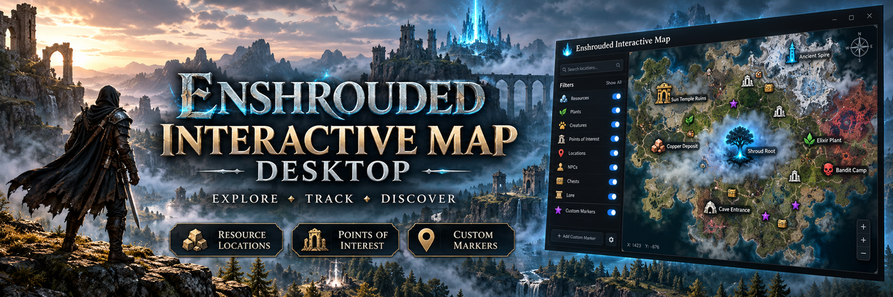

# Enshrouded Interactive Map Desktop: Embervale POIs & Routes for Windows 11

    

---

Enshrouded Interactive Map Desktop is a Windows desktop companion for Enshrouded that provides an interactive atlas of Embervale points of interest, map markers, resource zones, and exploration routes. The application organizes location data into a browsable map interface so players can inspect landmarks, review marker categories, and plan traversal paths across the game world. It is distributed as a packaged Windows build with bundled runtime files and accompanying configuration, and the repository supplies the documentation needed to obtain and operate the release. This project is an independent, community-maintained utility and is not affiliated with or endorsed by Keen Games.

## Features

- **Interactive map viewer:** a desktop surface for browsing Embervale points of interest and their spatial relationships within a unified map view.

- **Point-of-interest catalog:** structured entries for locations across Embervale, intended to support lookup and orientation during exploration planning.

- **Exploration route planning:** workflow support for assembling and reviewing travel paths between locations of interest before committing to an in-game route.

- **Desktop-native Windows package:** distributed as a ZIP archive containing a corresponding executable and bundled supporting files, with all directories and configuration kept together.

- **Self-contained runtime layout:** bundled directories, libraries, and configuration files are packaged alongside the executable so the application can be unpacked and reviewed as a single unit.

- **Offline-oriented operation:** designed to function as a local companion tool without requiring live external services for its core map and route workflows.

- **Documentation-driven workflow:** repository documentation describes obtaining the release, unpacking the Windows files, and understanding the intended usage flow for the atlas and route features.

- **Verification-first execution model:** the distribution is structured so users can inspect publisher details, file origin, and security scan results prior to running the executable.

- **Community-maintained, unofficial scope:** the project is an independent companion utility focused on Embervale exploration, with functionality scoped to map browsing and route planning rather than game modification.

## How It Works

Enshrouded Interactive Map Desktop operates as a local Windows companion application that renders Embervale map data through a packaged desktop executable. The application is distributed as a self-contained ZIP archive containing the executable and its bundled runtime dependencies, which are unpacked into a single working directory and launched directly from the Windows desktop.

**Data Layer.** The application organizes map information around discrete points of interest, each associated with positional coordinates, category metadata, and descriptive attributes. Embervale locations are grouped into logical regions and resource zones, allowing the map to be filtered and traversed by area rather than as a single flat dataset. Marker data is retained locally within the application directory, so the map remains usable without an active network connection.

**Rendering Pipeline.** On launch, the executable loads its bundled map layer and marker dataset into memory and composites them into an interactive viewport. Panning and zooming transform the viewport coordinates rather than rebuilding the underlying map, keeping navigation responsive across the full Embervale surface. Marker layers are drawn above the base map and updated incrementally as filters or selections change.

**Marker and Filter System.** Each point of interest carries category tags that drive the visibility controls exposed in the interface. Users toggle categories to isolate relevant markers, and the map re-renders the affected layer without reloading the full dataset. Selected markers surface their associated detail records, including location context and exploration notes, in a dedicated panel alongside the viewport.

**Route Planning Workflow.** Exploration routes are assembled by selecting a sequence of markers, which the application stores as an ordered path. Route data persists between sessions in the local configuration directory, so planned paths can be revisited and adjusted. The route layer is rendered as an overlay on the map, independent of the marker visibility state.

**Persistence and Configuration.** Application state — including filter selections, saved routes, and viewport preferences — is written to local configuration files within the installation directory. Because all persistence is file-based and local, backing up the application folder captures the complete working state, and no external service is contacted during normal operation.

**Distribution Model.** The executable is packaged with all required libraries in the same archive, so the application does not depend on system-wide runtime installations. Updates are delivered as replacement archives rather than in-place patching; extracting a new archive into a clean directory preserves the previous installation for comparison or rollback.

**Security Considerations.** Because the application is distributed as a prebuilt Windows executable outside any signed store channel, provenance verification is the responsibility of the user. The application performs no privileged operations on game installations and does not modify game data; any backup of game files should be taken independently before combining map-derived information with save or server configuration changes.

## Requirements

Enshrouded Interactive Map Desktop targets Windows 10 or Windows 11 (64-bit) on desktop hardware with a modern multi-core processor, at least 8 GB of system memory, and sufficient free disk space to hold the packaged distribution alongside any locally cached map data or game files. A display resolution of 1920×1080 or higher is recommended to render the Embervale atlas, layer controls, and marker panels without crowding the workspace. The application is distributed as a self-contained Windows package; no separate runtime installation, package manager, or command-line tooling is required to launch the executable. Network access is only needed to retrieve the packaged release and any documentation updates, while map browsing and route planning are intended to operate against local data. Users who maintain their own Embervale datasets should ensure the relevant files are readable by the application account and are organized in the directory structure described in the project documentation. Because the executable modifies local data during exploration workflows, an independent backup of game saves, configuration files, and any user-supplied map data should be created before first use. Administrative privileges are not required for standard operation and should only be granted when the user has verified the provenance of the executable and accepts the associated risk.

## Installation

## Installation

- Obtain the packaged release for Enshrouded Interactive Map Desktop from its published distribution channel and confirm the archive filename matches the expected release asset before proceeding.
- Extract the complete archive into a dedicated directory. Preserve the full folder hierarchy, including any bundled libraries, configuration files, and supporting directories; partial extraction will prevent the application from resolving its dependencies at startup.
- Verify the executable and supporting files against the publisher's stated checksums or signatures where provided. Review file origin and security scan results prior to first execution.
- Launch the primary executable from within the extracted directory only. Running it from inside a compressed archive or a relocated subset of files is unsupported.
- On first launch, allow the application to initialize its local configuration and map data store. Confirm that the Embervale points-of-interest dataset and exploration route data load without errors.
- Where the application exposes configurable paths for game data or map resources, set these explicitly rather than relying on defaults, and keep an independent backup of any referenced game data before modification.
- Confirm successful installation by verifying that map markers, location entries, and route planning views render and respond as documented.

## FAQ

**Is Enshrouded Interactive Map Desktop an official product?** No. It is an independent, community-maintained Windows companion project for Enshrouded and is not affiliated with, endorsed by, or sponsored by Keen Games.

**What is the intended scope of the project?** The application is designed around browsing Embervale points of interest and planning exploration routes. It is a reference and planning aid, not a game modification or server tool.

**Which Windows versions are supported?** The project targets Windows 10 and Windows 11. Verify the packaged release notes and executable metadata for the specific build before deployment.

**Does the application modify game files or save data?** No. The tool is a standalone desktop companion focused on map browsing and route planning. It does not write to Enshrouded installation directories or save files.

**Can the map be used offline?** Yes. The desktop package is self-contained and does not require a live connection to browse locations or plan routes once extracted.

**How are points of interest and routes stored?** Map data and route definitions are bundled within the application package. User-created routes are persisted locally; review the packaged configuration files for the exact storage location.

**Does renaming the executable change its behavior?** No. The executable name is a label only and does not alter functionality, feature gating, or data resolution.

**Can multiple map datasets be loaded?** The application resolves its bundled dataset at startup. Custom or updated datasets should follow the documented directory structure and file naming conventions described in the repository documentation.

**Is the packaged executable verified?** Runtime behavior of the supplied executable has not been independently verified in this package. Review the publisher, file origin, and security scan results before running it, and confirm the build matches the documented feature set.

**How should issues or feature discrepancies be reported?** Confirm the executable build and documentation version first, then report the discrepancy through the project's issue tracker with the build identifier and a description of the observed versus expected behavior.

**Is the project's source code available?** Documentation and repository metadata are provided under the MIT License to the extent the project owner holds the rights. Bundled binaries, third-party components, and game assets retain their own applicable licenses and are not automatically covered.

## License

Project-authored documentation, repository metadata, and original source code for Enshrouded Interactive Map Desktop are released under the **MIT License**, to the extent the project maintainers hold the rights to license them. This covers the README text, configuration files, and any first-party scripts or utilities created specifically for this project.

The MIT License permits use, copying, modification, merging, publication, distribution, sublicensing, and sale of covered components, provided that the original copyright notice and permission notice are retained in all copies or substantial portions of the software. Covered components are provided **as is**, without warranty of any kind, express or implied, including but not limited to warranties of merchantability, fitness for a particular purpose, and non-infringement.

The following are **not** covered by the project's MIT License and remain subject to their own respective terms:

- The packaged Windows executable, bundled DLLs, and any compiled binaries distributed alongside the project.
- Third-party libraries, frameworks, or assets incorporated into the release package.
- Game assets, textures, map data, or other materials derived from Enshrouded, which remain the property of their respective rights holders.
- Release archives and staging artifacts, which may combine project-authored and third-party components under separate terms.

No standalone LICENSE file is bundled with this package. Redistributors and downstream users are responsible for verifying the licensing status of each component before reuse, modification, or redistribution. Where the project's MIT License and a third-party license conflict for a given file, the third-party license governs that file.

